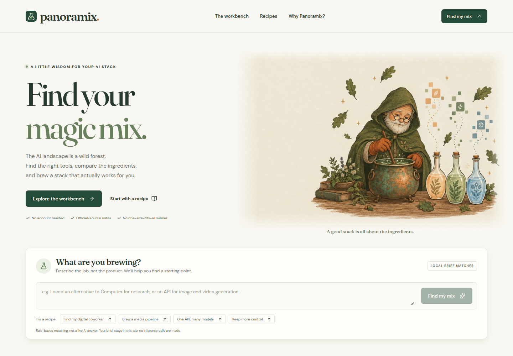
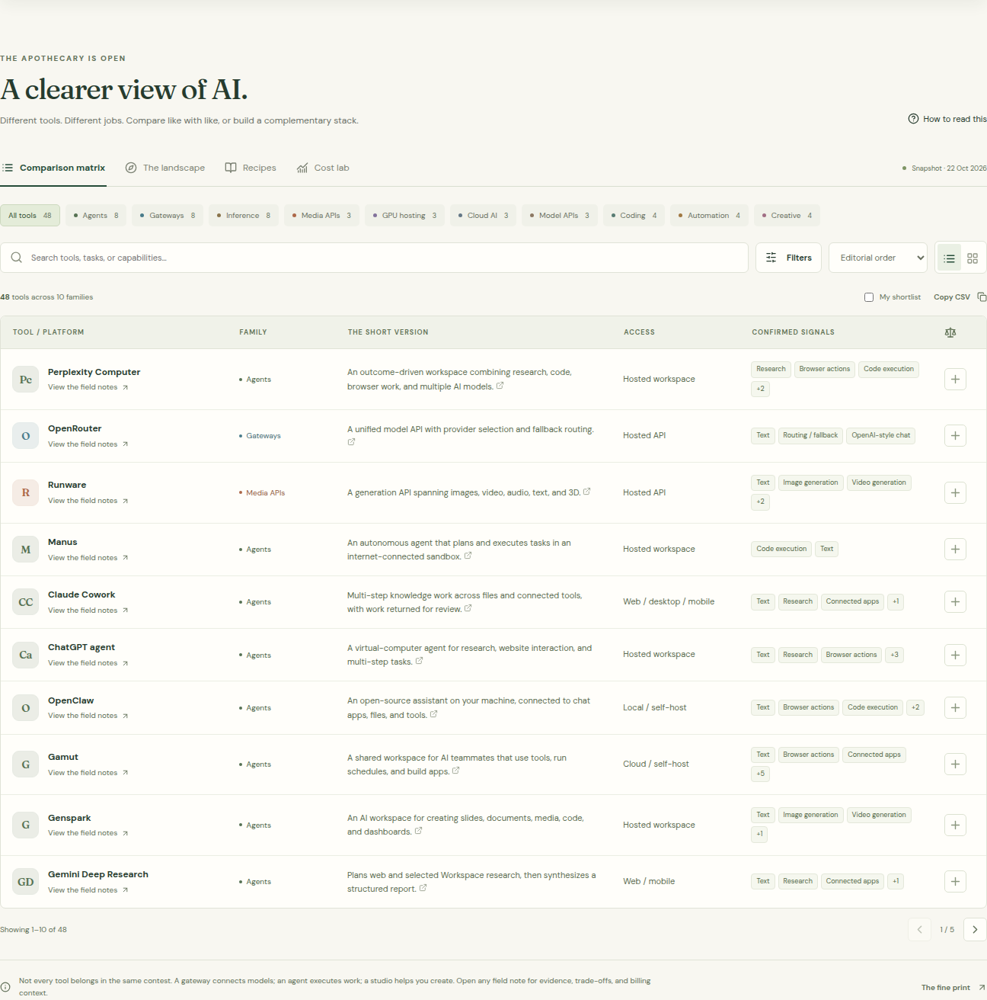
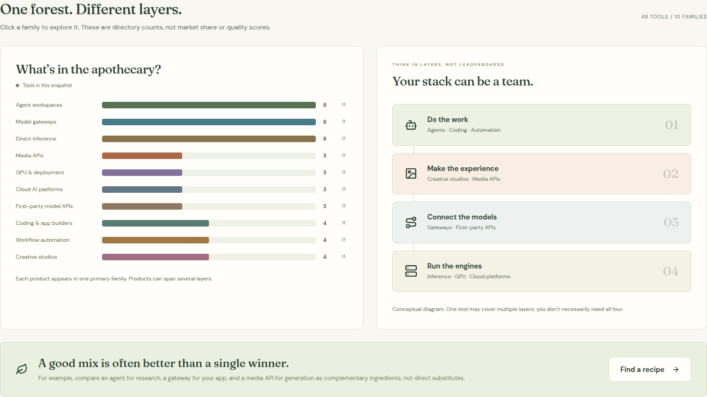
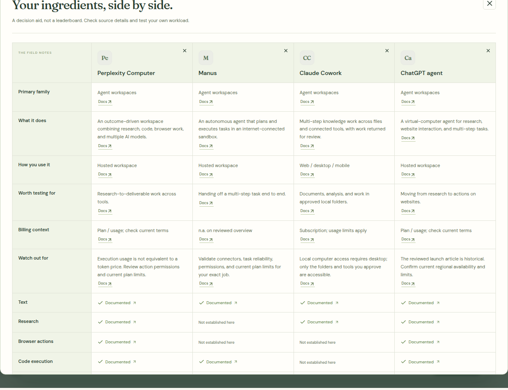
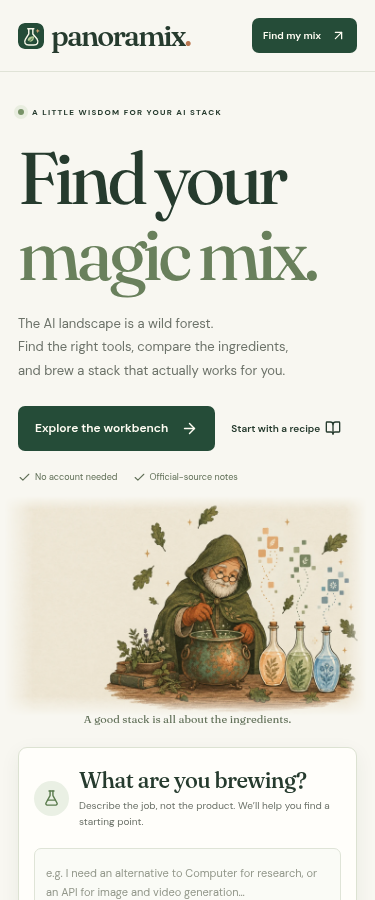

<div align="center">


# Panoramix

**Find your magic mix.**

<a href="https://askpanoramix.com"></a>


<a href="LICENSE"></a>
<a href="https://github.com/paulfxyz/panoramix/actions/workflows/validate.yml"></a>

<a href="https://askpanoramix.com"></a>

<p>The AI landscape is a wild forest. Panoramix helps you compare the ingredients.<br>Agents, model gateways, inference, media, coding, automation and creative studios, in one open workbench.</p>
<p>No universal winner. No fake benchmark league. No app login, database server or paid AI call.<br>A static site you can read, copy, host and improve.</p>

</div>

<table>
<tr>
<th width="33%" align="left">BROWSE<br>The workbench</th>
<th width="33%" align="left">HOST<br>Your own copy</th>
<th width="33%" align="left">CONTRIBUTE<br>A better ingredient</th>
</tr>
<tr valign="top">
<td>Describe a job, start from a recipe, filter the catalogue and compare up to four tools with official-source field notes.</td>
<td>Download the static ZIP, extract it, and upload the contents over FTP/FTPS. SiteGround or almost any ordinary static host will do.</td>
<td>Submit a source-backed JSON report. Maintainers review and combine community findings into periodic catalogue updates.</td>
</tr>
<tr valign="top">
<td><a href="#what-you-get">What you get</a></td>
<td><a href="#upload-to-siteground">Hosting guide</a></td>
<td><a href="CONTRIBUTING.md">The report standard</a></td>
</tr>
</table>

<p align="center"><a href="#what-you-get">Features</a> · <a href="#upload-to-siteground">SiteGround</a> · <a href="#edit-the-catalogue-without-rebuilding">Edit JSON</a> · <a href="CONTRIBUTING.md">Community reports</a> · <a href="#development">Development</a> · <a href="CHANGELOG.md">Changelog</a> · <a href="SECURITY.md">Security</a> · <a href="#why-panoramix">The name</a></p>

An elegant, open-source AI comparison workbench for [askpanoramix.com](https://askpanoramix.com), built to run on ordinary static hosting including SiteGround. The domain is the intended public home; preparing this repository and its ZIP does not configure the hosting account or publish the domain.

The initial catalogue covers 48 tools in 10 families: agent workspaces, model gateways, direct inference, media APIs, GPU deployment, cloud AI, first-party model APIs, coding/app builders, automation and creative studios. Computer-style agents are compared as workspaces, not confused with model APIs.

## What you get

The production site is HTML, CSS, browser JavaScript, an original illustration, and one local `catalog.json` file. No Node process, SQL service, PHP, build tool, API key, paid AI call, analytics or external account is required by the deployed app. Font stylesheets come from Google Fonts; local fallbacks remain usable if that service is unavailable. Build tools are only needed when changing application code.

- **Browse:** search, family filters, confirmed-signal filters, table/card views and pagination.
- **Decide:** a four-tool comparison tray with sourced field notes and explicit trade-offs.
- **Ask:** a local, rule-based brief matcher that suggests relevant ingredients without calling an LLM.
- **Start quickly:** ten reusable comparison recipes.
- **See the landscape:** clickable directory-count charts and a conceptual stack diagram.
- **Model costs:** enter your own comparable quotes for tokens, media outputs, GPU hours or seats.
- **Take notes:** copy comparison text or CSV. Session state is ephemeral; no browser storage or account sync.
- **Contribute:** submit source-backed JSON reports for periodic, reviewed catalogue updates.



<details>
<summary>See the landscape, side-by-side comparison and mobile experience</summary>





</details>

## Upload to SiteGround

1. Download the `panoramix-siteground` build artifact from a successful GitHub Actions run, or build it yourself with `npm run package:site`.
2. Extract `panoramix-siteground.zip`. Upload its **contents**, not the outer folder, to the configured document root for `askpanoramix.com` using your FTP/FTPS client.
3. Confirm that `index.html`, `catalog.json`, the illustration and the `assets/` folder are siblings. Include `.htaccess` if your FTP client hides dotfiles.
4. Finish the domain and HTTPS setup in your hosting account. These are hosting-side operations, not requirements for a database.
5. Open the HTTPS site and test search, filters, recipes, comparison, cost calculations and the source links. If host-level caching shows an older build, purge it and recheck.

The bundle uses relative asset paths, so it can also be copied into a subdirectory or another static host. No SPA rewrite is needed: navigation is in-page. The included `.htaccess` adds MIME types, cache preferences and basic headers on compatible Apache hosting; the app also works on static hosts that ignore that file.

Do not double-click `index.html` through `file://`; browsers restrict loading the local JSON that way. Serve the folder over HTTP or HTTPS. For a local smoke test:

```sh
cd dist/public
python3 -m http.server 8080
```

Then open `http://localhost:8080`. This is only a local test server, not a production requirement.

## Edit the catalogue without rebuilding

The source of truth is [`client/public/catalog.json`](client/public/catalog.json). It is copied unchanged beside `index.html` in the static build and loaded at runtime.

1. Edit a tool record or merge approved research reports.
2. Run `npm run validate` and `npm test`.
3. Change `updated` to the date of the reviewed catalogue update, not a claim that all providers were re-audited.
4. Upload that JSON as `catalog.json` next to the existing deployed `index.html`.

The browser will request a fresh catalogue on load. Any host/CDN cache may still need a purge. Tool counts, family counts and the visible snapshot date derive from the JSON. New family IDs or capability IDs require a code/schema update. Keep JSON valid and preserve stable IDs used by recipes and reports.

## Community research standard

Read [CONTRIBUTING.md](CONTRIBUTING.md) for the complete standard, evidence rules, batch review procedure and conflict handling.

- Schema: [`reports/report.schema.json`](reports/report.schema.json)
- Copyable example: [`reports/examples/example-report.json`](reports/examples/example-report.json)
- Incoming proposals: `reports/incoming/` in contributor PRs, or the Research report issue form
- Accepted evidence/archive: `reports/merged/`

```sh
npm run report:merge -- --report reports/incoming/a.json --report reports/incoming/b.json --dry-run
# Human review of sources and the printed plan, then:
npm run report:merge -- --report reports/incoming/a.json --report reports/incoming/b.json --apply --expect-hash REVIEWED_HASH
npm test && npm run check && npm run package:site
```

Conflicting proposals or stale expected values abort. Matching proposals combine their evidence. Submissions never directly modify the live site. Maintainers merge and republish periodically according to community findings; no automatic paid polling, deployment or recurring job is installed.

## Development

Node 22 or later is recommended.

```sh
npm ci
npm run dev             # http://localhost:5000
npm test                # catalogue, report and conflict tests
npm run check           # TypeScript
npm run package:site    # dist/public + dist/panoramix-siteground.zip
```

GitHub Actions runs validation, tests, type checking and packaging for pushes, pull requests and manual runs. It does not need secrets and does not deploy to your web host.

An additional, strictly manual [SiteGround FTPS workflow](docs/DEPLOYMENT.md) is available if you prefer encrypted GitHub secrets to an FTP client. It checks and proves the document root, requires a reviewed existing-index hash, and never runs on a push or community submission.

## Repository layout

```text
client/
  index.html                    HTML entry, metadata and social preview
  src/App.tsx                   Workbench, landing page and controls
  src/data.ts                   Catalogue loader and local matcher
  src/index.css                 Apothecary design, responsive layout and effects
  public/catalog.json           Editable public catalogue, loaded at runtime
  public/panoramix-mark.svg     Original potion-leaf identity
  public/panoramix-apothecary.webp  Original alchemist illustration
scripts/
  catalog-lib.mjs               Record validation and conflict-safe combining
  merge-reports.mjs             Dry-run / reviewed-hash apply
  validate.mjs                  Catalogue and report checks
reports/
  report.schema.json            Community interchange standard
  examples/example-report.json  Copyable, non-fresh-research example
tests/                          Catalogue and merge regression checks
docs/                           Real screenshots and logo assets
.github/workflows/validate.yml  Test, typecheck, build, package
dist/public/                    Generated static site, not source-controlled
dist/panoramix-siteground.zip   Ready-to-upload release package
```

## Research and decision limits

Initial research snapshot: 22 October 2026. The directory is curated and not exhaustive. Some official sources are historical launch posts. Product names, availability, capabilities and terms change. Provider links sit beside facts; record-level `source`, optional `extra` and community `evidence` fields preserve provenance.

Family classification, use cases and caution notes are editorial. A documented signal is not an audit, certification or exhaustive feature list. Unconfirmed means unknown, not unsupported. Self-hosting does not automatically mean private or offline inference. OpenAI-style compatibility does not guarantee endpoint parity. Vision input is not image generation.

The local brief matcher rewards family matches, confirmed capabilities, explicit names and task tags. It is a shortlist aid, not a language model, benchmark engine or strict constraint solver. Explicit filters are the way to require documented signals. The cost calculator only calculates rates entered by the visitor; it does not fetch prices or estimate Computer credit use.

## Why Panoramix?

Panoramix (Getafix in English) is Astérix's village druid, keeper of wisdom and the magic potion recipe, as described on the [official character page](https://asterix.com/personnages/panoramix/). The analogy: AI tools are ingredients, and a thoughtful combination matters more than a mythical universal winner.

This is an independent project and an affectionate nod, not an Astérix product or endorsement. The original alchemist illustration is AI-generated and is not a depiction of the comic character. Consider third-party naming and trademark rights before commercial use.

## Open source

Code, original editorial data, docs and original project artwork are offered under [MIT](LICENSE), to the extent the contributors hold the rights. Third-party dependencies retain their own licenses. Names, brands, characters, model weights and linked source content are not relicensed. See [THIRD_PARTY_NOTICES.md](THIRD_PARTY_NOTICES.md).

Created by [Paul Fleury](https://github.com/paulfxyz), with Perplexity Computer. Companion project and repository-presentation reference: [Megamesh](https://github.com/paulfxyz/megamesh).
