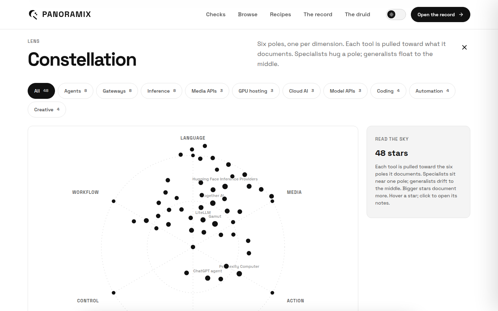
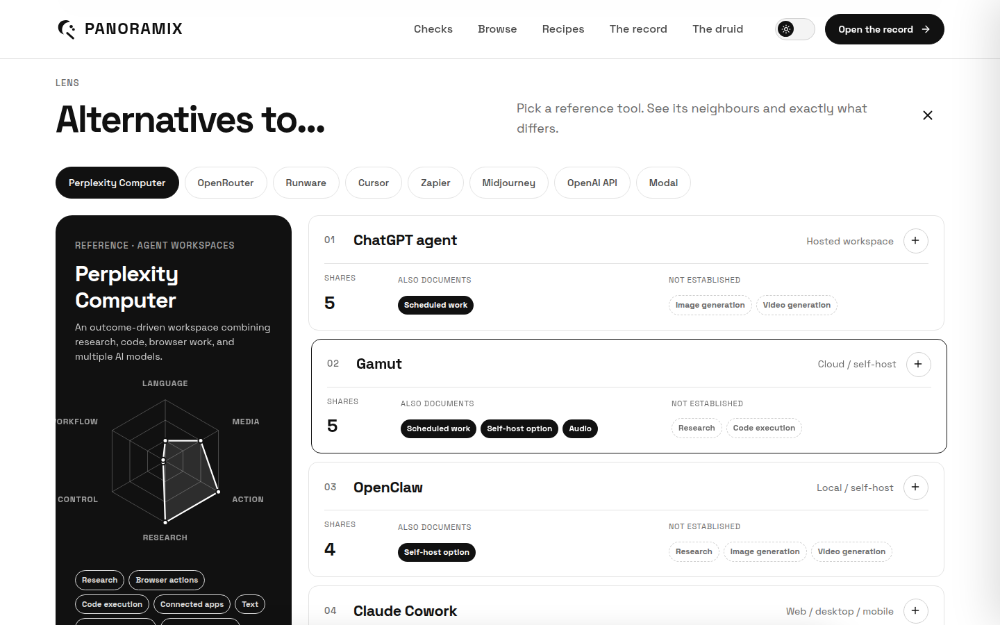
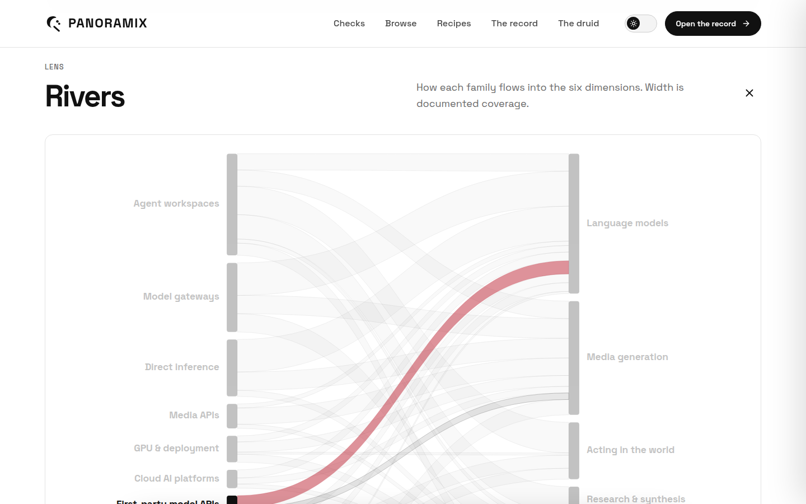
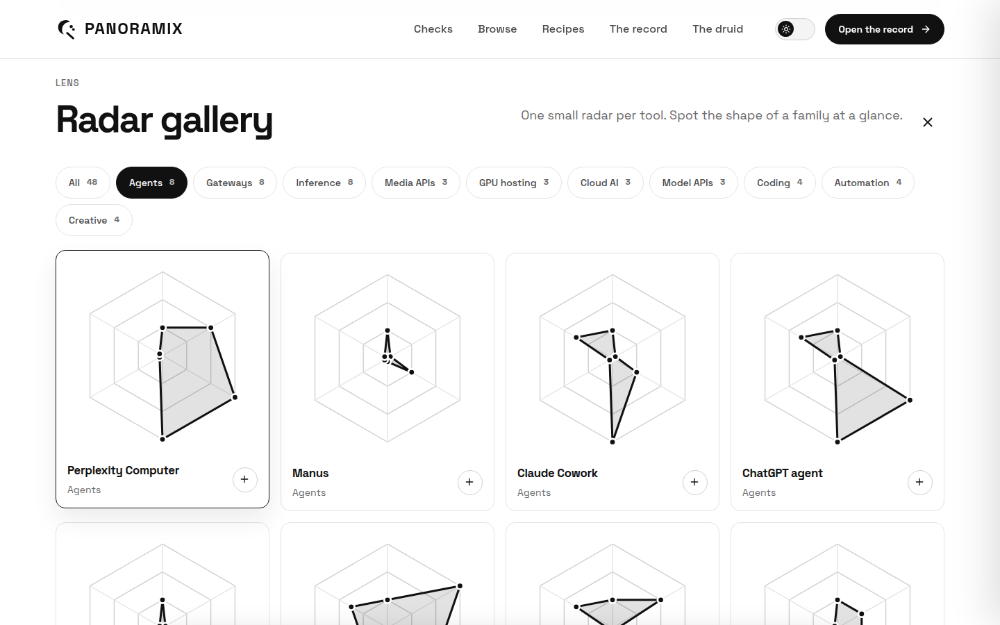
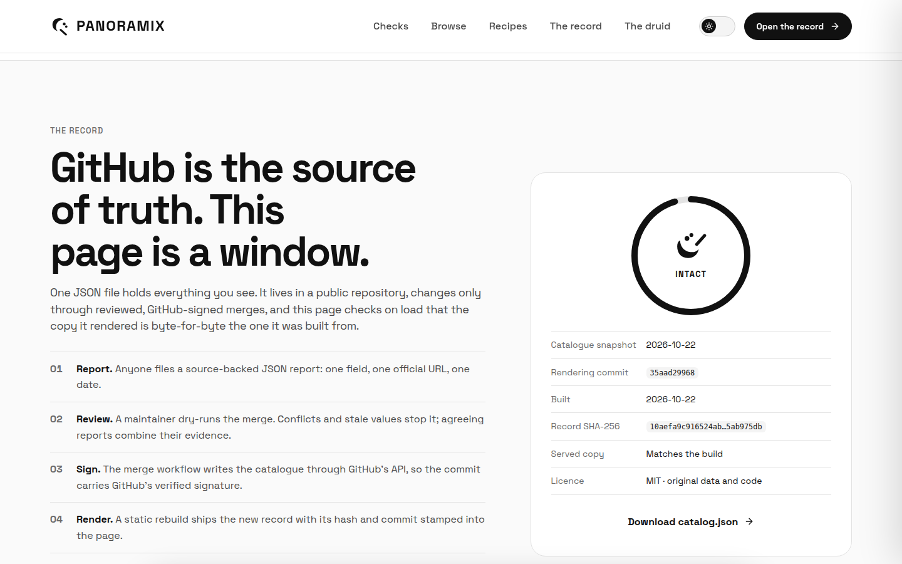

<div align="center">


# Panoramix

**Find your magic mix.**

<a href="https://askpanoramix.com"></a>


<a href="LICENSE"></a>
<a href="https://github.com/paulfxyz/panoramix/actions/workflows/validate.yml"></a>

<a href="https://askpanoramix.com"></a>

<p><strong>An open, GitHub-signed record of what AI tools document.</strong><br>Agents, model gateways, inference, media, coding, automation and creative studios, compared like with like.</p>
<p>GitHub is the source of truth. <a href="https://askpanoramix.com">askpanoramix.com</a> only renders the record: 45 common checks, seven lenses, no account, nothing to type, no AI call.<br>("ask" is just the domain. Nobody is asked anything.)</p>

</div>

<table>
<tr>
<th width="33%" align="left">READ<br>The record</th>
<th width="33%" align="left">HOST<br>Your own copy</th>
<th width="33%" align="left">CONTRIBUTE<br>A better ingredient</th>
</tr>
<tr valign="top">
<td>Pick one of 45 common checks or seven lenses: radar gallery, capability matrix, constellation, rivers, alternatives, checklist, stack builder. Compare up to four tools with a plain-English verdict.</td>
<td>Download the static ZIP, extract it, and upload the contents over FTP/FTPS. SiteGround or almost any ordinary static host will do.</td>
<td>Submit a source-backed JSON report. Maintainers review, then the signed-merge workflow commits the new record through GitHub's API with a verified signature.</td>
</tr>
<tr valign="top">
<td><a href="#what-you-get">What you get</a></td>
<td><a href="#upload-to-siteground">Hosting guide</a></td>
<td><a href="CONTRIBUTING.md">The report standard</a></td>
</tr>
</table>

<p align="center"><a href="#what-you-get">Features</a> · <a href="#upload-to-siteground">SiteGround</a> · <a href="#edit-the-catalogue-without-rebuilding">Edit JSON</a> · <a href="CONTRIBUTING.md">Community reports</a> · <a href="#development">Development</a> · <a href="CHANGELOG.md">Changelog</a> · <a href="SECURITY.md">Security</a> · <a href="#why-panoramix">The name</a></p>

Panoramix is a record, not a product. One JSON file, [`client/public/catalog.json`](client/public/catalog.json), holds everything: 48 tools, 10 families, 15 documented capabilities, every claim tied to an official URL. It changes only through reviewed merges that are committed via GitHub's API and therefore carry GitHub's verified signature. The static site at [askpanoramix.com](https://askpanoramix.com) is a window onto that file: it embeds the record's SHA-256 and the rendering commit at build time, re-hashes the served copy on load, and shows an **Intact / Altered** seal.

The initial catalogue covers 48 tools in 10 families: agent workspaces, model gateways, direct inference, media APIs, GPU deployment, cloud AI, first-party model APIs, coding/app builders, automation and creative studios. Computer-style agents are compared as workspaces, not confused with model APIs.

## What you get

The production site is HTML, CSS, browser JavaScript, five original engraved illustrations and `catalog.json`. No Node process, SQL service, PHP, API key, paid AI call, analytics, external account or free-text input is required by the deployed app. Space Grotesk loads from Google Fonts with a system fallback.

**45 common checks.** The questions people run most often against the record, grouped: Alternatives, Agents, Models & APIs, Images/video/audio, Control & privacy, Building, The big picture. Each opens a fixed, reproducible view. Same record, same answer, for everyone.

**Seven lenses.**

| Lens | What it shows |
|---|---|
| Radar gallery | One small six-axis radar per tool; the shape of a family at a glance |
| Capability matrix | Every tool × every capability, sticky headers, filled dot = documented |
| Constellation | RadViz sky: six poles, each tool pulled toward what it documents; bigger stars document more |
| Rivers | Ribbons from the ten families into the six dimensions; width = documented coverage |
| Alternatives to… | A reference tool on the left; same-family neighbours ranked, with what each adds and lacks |
| I need… | Tick capabilities (and optionally a family); keep only tools documenting all of them |
| Stack builder | One tool per layer (Do / Make / Connect / Run); combined radar and coverage; compare the stack |

**Compare up to four.** Dock, then Radar / Bars / Matrix / Facts. The matrix lists differences first, then what all share, then what none document. A plain-English verdict summarises: who documents the most, what everyone shares, what only one has, and a reminder when you are comparing across families.

**The record seal.** Snapshot date, rendering commit, record SHA-256 and whether the served copy matches the build.

The six dimensions (Language, Media, Action, Research, Control, Workflow) are derived purely from documented features: each axis is the share of that dimension's tracked features that the official source documents. They are coverage indicators, not quality scores.


<details>
<summary>See the lenses, the compare view, the record seal and mobile</summary>









</details>

## Upload to SiteGround

1. Download the [ready-to-host v1.2.0 ZIP](packages/panoramix-siteground-v1.2.0.zip) and [checksum](packages/SHA256SUMS), get the `panoramix-siteground` artifact from a successful GitHub Actions run, or build it yourself with `npm run package:site`. A GitHub source-code ZIP is not the compiled hosting package.
2. Extract `panoramix-siteground.zip`. Upload its **contents**, not the outer folder, to the configured document root for `askpanoramix.com` using your FTP/FTPS client.
3. Confirm that `index.html`, `catalog.json`, the `art/` folder and the `assets/` folder are siblings. Include `.htaccess` if your FTP client hides dotfiles.
4. Finish the domain and HTTPS setup in your hosting account. These are hosting-side operations, not requirements for a database.
5. Open the HTTPS site and test a few checks, each lens, the drawer, the four compare views, recipes, the record seal and the source links. If host-level caching shows an older build, purge it and recheck.

The bundle uses relative asset paths, so it can also be copied into a subdirectory or another static host. No SPA rewrite is needed: navigation is in-page. The included `.htaccess` adds MIME types, cache preferences and basic headers on compatible Apache hosting; the app also works on static hosts that ignore that file.

Do not double-click `index.html` through `file://`; browsers restrict loading the local JSON that way. Serve the folder over HTTP or HTTPS. For a local smoke test:

```sh
cd dist/public
python3 -m http.server 8080
```

Then open `http://localhost:8080`. This is only a local test server, not a production requirement.

## Edit the catalogue without rebuilding

The source of truth is [`client/public/catalog.json`](client/public/catalog.json). It is copied unchanged beside `index.html` in the static build and loaded at runtime.

1. Edit a tool record or merge approved research reports.
2. Run `npm run validate` and `npm test`.
3. Change `updated` to the date of the reviewed catalogue update, not a claim that all providers were re-audited.
4. Upload that JSON as `catalog.json` next to the existing deployed `index.html`.

The browser will request a fresh catalogue on load. Any host/CDN cache may still need a purge. Tool counts, family counts and the visible snapshot date derive from the JSON. New family IDs or capability IDs require a code/schema update. Keep JSON valid and preserve stable IDs used by recipes and reports.

## How the record changes

1. **Report.** Anyone files a source-backed JSON report (`reports/report.schema.json`): one field, one official URL, one date, one note.
2. **Review.** A maintainer dry-runs `npm run report:merge`. Conflicting proposals and stale expected values abort; agreeing reports combine their evidence. The dry run prints the current record hash.
3. **Sign.** The [Signed catalogue merge](.github/workflows/signed-merge.yml) workflow re-runs the dry run, applies with the reviewed hash, validates, and commits `catalog.json` (and archived evidence) through GitHub's Contents API. Commits made this way are signed by GitHub and show as **Verified**.
4. **Render.** A static rebuild stamps the new record hash and commit into the page; the deploy workflow ships it. The site re-hashes `catalog.json` on every load and shows Intact or Altered.

Code commits may be unsigned; the record's history is what the signed path protects. There is no blockchain and no token: a public Git history with verified signatures and a content hash on the page is the whole trust model.

## Community research standard

Read [CONTRIBUTING.md](CONTRIBUTING.md) for the complete standard, evidence rules, batch review procedure and conflict handling.

- Schema: [`reports/report.schema.json`](reports/report.schema.json)
- Copyable example: [`reports/examples/example-report.json`](reports/examples/example-report.json)
- Incoming proposals: `reports/incoming/` in contributor PRs, or the Research report issue form
- Accepted evidence/archive: `reports/merged/`

```sh
npm run report:merge -- --report reports/incoming/a.json --report reports/incoming/b.json --dry-run
# Human review of sources and the printed plan, then:
npm run report:merge -- --report reports/incoming/a.json --report reports/incoming/b.json --apply --expect-hash REVIEWED_HASH
npm test && npm run check && npm run package:site
```

Conflicting proposals or stale expected values abort. Matching proposals combine their evidence. Submissions never directly modify the live site. Maintainers merge and republish periodically according to community findings; no automatic paid polling, deployment or recurring job is installed.

## Development

Node 22 or later is recommended.

```sh
npm ci
npm run dev             # http://localhost:5000
npm test                # catalogue, report and conflict tests
npm run check           # TypeScript
npm run package:site    # dist/public + dist/panoramix-siteground.zip
```

The validation workflow runs tests, type checking and packaging for pushes, pull requests and manual runs. It does not need secrets and never deploys to your web host.

An additional, strictly manual [SiteGround FTPS workflow](docs/DEPLOYMENT.md) is available if you prefer encrypted GitHub secrets to an FTP client. It checks and proves the document root, requires a reviewed existing-index hash, and never runs on a push or community submission.

## Repository layout

```text
client/
  index.html                    HTML entry, metadata and social preview
  src/App.tsx                   Landing, checks cloud, lens panel, browse, drawer, compare, record
  src/lenses.tsx                Seven lenses: radars, matrix, constellation, rivers, alternatives, checklist, stack
  src/questions.ts              The 45 common checks and the view each one opens
  src/data.ts                   Record loader, six derived dimensions, integrity hash
  src/index.css                 Monochrome design system, Space Grotesk, motion
  public/catalog.json           Editable public catalogue, loaded at runtime
  public/panoramix-mark.svg     Original sickle-and-mistletoe mark
  public/art/*.webp             Five original engraved illustrations
scripts/
  catalog-lib.mjs               Record validation and conflict-safe combining
  merge-reports.mjs             Dry-run / reviewed-hash apply
  validate.mjs                  Catalogue and report checks
reports/
  report.schema.json            Community interchange standard
  examples/example-report.json  Copyable, non-fresh-research example
tests/                          Catalogue and merge regression checks
docs/                           Real screenshots and logo assets
.github/workflows/validate.yml  Test, typecheck, build, package
.github/workflows/signed-merge.yml  Reviewed merge committed via GitHub API (verified signature)
.github/workflows/deploy-siteground.yml  Manual, proof-gated FTPS deploy
dist/public/                    Generated static site, not source-controlled
dist/panoramix-siteground.zip   Ready-to-upload release package
```

## Research and decision limits

Initial research snapshot: 22 October 2026. The directory is curated and not exhaustive. Some official sources are historical launch posts. Product names, availability, capabilities and terms change. Provider links sit beside facts; record-level `source`, optional `extra` and community `evidence` fields preserve provenance.

Family classification, use cases and caution notes are editorial. A documented signal is not an audit, certification or exhaustive feature list. Unconfirmed means unknown, not unsupported. Self-hosting does not automatically mean private or offline inference. OpenAI-style compatibility does not guarantee endpoint parity. Vision input is not image generation.

There is no free-text input and no matcher: the 45 checks are hand-written views of the record, so two people opening the same check see the same thing. Panoramix does not fetch prices or estimate credit use; billing context is a pointer to the official terms.

## Why Panoramix?

Panoramix (Getafix in English) is Astérix's village druid, keeper of wisdom and the magic potion recipe, as described on the [official character page](https://asterix.com/personnages/panoramix/). The analogy: AI tools are ingredients, and a thoughtful combination matters more than a mythical universal winner.

This is an independent project and an affectionate nod, not an Astérix product or endorsement. Our druid is an original character drawn in a copperplate-engraving style: white beard, hooded robe, golden sickle, mistletoe, oak, cauldron and menhirs are Gaulish and druidic motifs from history and folklore, not the comic's character design. The illustrations are AI-generated originals. Consider third-party naming and trademark rights before commercial use.

### Design

The interface is monochrome at rest, in the spirit of [Calliope](https://calliope.agency): black and white, Space Grotesk set large and bold, pill buttons, 24px cards, generous spacing and hand-drawn-looking illustrations. Red appears only as a transient response to hover, focus and touch. Motion is deliberate: buttons lift with a soft halo and a light sweep, fields grow a red underline on focus, cards rise into view, the drawer slides in, radars unfold and bars grow. Everything respects `prefers-reduced-motion`.

## Open source

Code, original editorial data, docs and original project artwork are offered under [MIT](LICENSE), to the extent the contributors hold the rights. Third-party dependencies retain their own licenses. Names, brands, characters, model weights and linked source content are not relicensed. See [THIRD_PARTY_NOTICES.md](THIRD_PARTY_NOTICES.md).

Created by [Paul Fleury](https://github.com/paulfxyz), with Perplexity Computer. Companion project and repository-presentation reference: [Megamesh](https://github.com/paulfxyz/megamesh).
